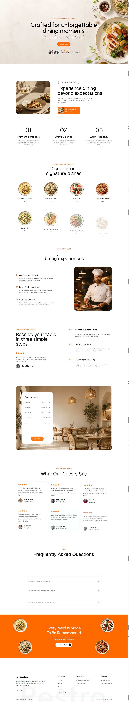

# Restro — Restaurant Website

Restro is a modern, responsive restaurant website designed to deliver an elegant and engaging online experience. Built with React, Vite, and Tailwind CSS, the project features a clean interface, subtle animations, and reusable components.

## Overview

The website showcases a restaurant's identity, highlights its services, presents customer testimonials, and encourages visitors to book a table through a clear call to action.

## Features

- Responsive layout for mobile, tablet, and desktop devices
- Modern restaurant-focused user interface
- Reusable React components
- Animated content sections and visual transitions
- Restaurant introduction and feature highlights
- Table booking call-to-action section
- Opening hours display
- Customer testimonials with star ratings
- Interactive FAQ accordion
- Lucide icons
- Custom food imagery and visual elements
- Responsive navigation and footer

## Technologies Used

- React
- JavaScript
- Vite
- Tailwind CSS
- Lucide React
- Motion for React animations
- Lenis for smooth scrolling, if enabled

## Project Structure

```text
Restro-Website/
├── public/
│   └── assets/
├── src/
│   ├── components/
│   │   └── Animated.jsx
│   ├── data/
│   │   └── data.js
│   ├── sections/
│   │   ├── Navbar.jsx
│   │   ├── Hero.jsx
│   │   ├── About.jsx
│   │   ├── Features.jsx
│   │   ├── BookingProcess.jsx
│   │   ├── Timing.jsx
│   │   ├── TestimonialSection.jsx
│   │   ├── FAQs.jsx
│   │   ├── Cta.jsx
│   │   └── Footer.jsx
│   ├── App.jsx
│   ├── index.css
│   └── main.jsx
├── index.html
├── package.json
└── README.md
```

*Note: This structure is illustrative. Update the filenames and directories to match the actual project.*

## Getting Started

### Prerequisites

Make sure the following tools are installed on your system:

- Node.js
- npm
- Git

### Installation

**1. Clone the repository**

```bash
git clone YOUR_GITHUB_REPOSITORY_URL
```

**2. Navigate to the project directory**

```bash
cd Restro-Website
```

**3. Install dependencies**

```bash
npm install
```

**4. Start the development server**

```bash
npm run dev
```

Open the local URL provided in your terminal. By default, Vite commonly uses:

```text
http://localhost:5173
```

### Production Build

To create an optimized production build, run:

```bash
npm run build
```

To preview the production build locally:

```bash
npm run preview
```

## Design and User Experience

The website uses a clean visual hierarchy, balanced spacing, rounded interface elements, and a warm orange accent color. Responsive layouts help maintain usability across different screen sizes.

Subtle animations and hover transitions enhance the experience without distracting from the content.

## Responsive Design

The layout uses Tailwind CSS responsive utilities to adapt to different devices.

- **Mobile:** Compact layouts and vertically stacked content.
- **Tablet:** Flexible spacing and multi-column layouts where appropriate.
- **Desktop:** Wider content sections and expanded grid layouts.

## Screenshots

Add screenshots of the completed website to showcase its design.

```text
screenshots/
├── homepage.png
└── responsive-layout.png
```

Once these images exist, reference them in this section:

```md



```

## Future Improvements

- Functional table reservation system
- Backend integration for booking management
- Interactive restaurant menu and category filtering
- Online ordering functionality
- Payment integration
- Accessibility and performance enhancements

## Author

**Al Amin**

- GitHub: [GitHub Profile](Yhttps://github.com/ALAMIN761740)


## License

This project was developed for learning and portfolio purposes. A license can be added to define the terms of use and distribution.

---

Developed as a restaurant website project using modern frontend technologies.
